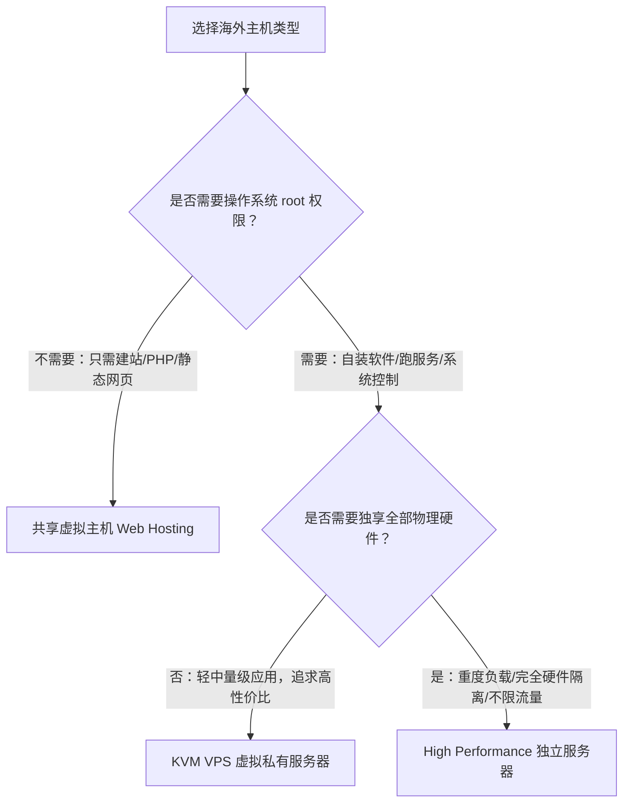

# Ethernet Servers 选购完全指南：第一次买海外主机，如何选对不踩坑？

选购海外服务器或云服务时，许多初学者往往会陷入两个极端：要么盲目迷信国际一线巨头，面对动辄数十项复杂的按量计费清单和陡峭的学习门槛无从下手；要么在各种超低价促销的“年付灵车”之间摇摆，最后连基础的数据安全和网络稳定性都无法保障。

如果你希望找一家**资历久、价格亲民、管理面板现代化，而且不用额外加钱就自带异地每日备份**的海外主机商，**[Ethernet Servers 官网](https://www.ethernetservers.com/aff.php?aff=3271)** 是一个非常值得放进候选清单的实用派品牌。

本文面向第一次认真挑选海外服务器的普通用户，抛开晦涩的技术黑话，把 Ethernet Servers 的产品类型、底层优势、技术限制、机房网络以及完整的价格周期账本拆解明白，帮助你快速确定哪一款配置真正契合你的实际需求。

---

## 目录
- [一、为什么 Ethernet Servers 值得关注？](#一为什么-ethernet-servers-值得关注)
- [二、适合谁？不适合谁？](#二适合谁不适合谁)
- [三、三大产品线深度拆解与选型取舍](#三三大产品线深度拆解与选型取舍)
  - [1. 共享虚拟主机（Web Hosting）：免运维建站优选](#1-共享虚拟主机web-hosting免运维建站优选)
  - [2. KVM VPS：兼顾控制权与高性价比的独立系统](#2-kvm-vps兼顾控制权与高性价比的独立系统)
  - [3. 独立物理服务器（Dedicated Server）：独享硬件与不限流量](#3-独立物理服务器dedicated-server独享硬件与不限流量)
- [四、官方产品配置与月付规格表](#四官方产品配置与月付规格表)
- [五、付款周期与省钱算账：怎么买最划算？](#五付款周期与省钱算账怎么买最划算)
  - [多周期折扣与优惠码使用注意](#多周期折扣与优惠码使用注意)
  - [全部付款周期价格明细对照表](#全部付款周期价格明细对照表)
- [六、新手落地使用与避坑实用建议](#六新手落地使用与避坑实用建议)

---

## 一、为什么 Ethernet Servers 值得关注？

在鱼龙混杂的海外平价主机市场中，Ethernet Servers 之所以能平稳运营多年并积累稳固口碑，核心在于它身上几个非常鲜明的特征：

1. **开箱即用的异地备份体系（极其省心）**  
   很多廉价 VPS 往往为了压缩成本，彻底剔除备份功能，或者将每日自动快照作为昂贵的收费增值项。而在 Ethernet Servers：
   - **KVM VPS 全系标配每日异地自动备份，保留 7 天历史**。即便你误删了环境或者系统配置崩溃，也能通过面板随时回滚。
   - **虚拟主机全系标配每日自动备份，保留 30 天历史**。这对于没有专业数据库维护经验的个人站长来说，相当于多了一道安全网。
2. **轻量现代的管理面板**  
   与许多依然使用老旧 SolusVM 面板的低价主机商不同，Ethernet Servers 的 VPS 产品线全面采用了 **VirtFusion 控制面板**。VirtFusion 界面简洁、现代且响应极快，开机、重装系统、VNC 控制台连接、反向域名解析（rDNS）设置以及备份恢复都可以在同一个现代化界面下直观完成。
3. **给力的资源额度与上联带宽**  
   Ethernet Servers 的 VPS 宿主机提供高达 **10Gbps 的共享上联端口**，单机月出站流量额度从 3000GB 起步，且**入站流量完全不限**。对于下载、同步外部数据或做常规出海业务的用户而言，网络余量相当充裕。
4. **务实透明的定价策略**  
   入门级 VPS 与共享主机月付只需 $3 起，同时支持按季度、半年、1年、2年乃至3年付款。长周期付款享有最高 25% 的梯度折扣，适合明确需要长期挂机、稳定建站的长期项目。

---

## 二、适合谁？不适合谁？

没有任何一家主机商能满足所有人。理智的选购前提是看清它的能力边界。

### 它非常适合：
- **跨境出海与多站点博主**：想要搭建海外独立站、个人博客、企业展示站，希望有成熟面板、免费 SSL 证书与长期数据备份支持，省去自己装系统的麻烦。
- **开发者与学习实践者**：需要一个自带独立 IPv4、完整 root 权限的轻量 Linux 环境，用于跑自动化脚本、测试容器、跑定时爬虫、搭建小型私有网盘或代码仓库。
- **大流量与轻度下载节点需求**：需要几千 GB 级别的高额出站流量，且有大量入站传输（如数据拉取、外部抓包同步），希望享有高突发网络上联。
- **高性价比独立硬件需求者**：寻求一台真正独享硬件资源、带有独享万兆内网与千兆公网不限流量的物理机器，用于中大型数据库或业务后台。

### 它不太适合：
- **极度依赖中国大陆直连优化线路（如 CN2 GIA / 9929）的用户**：Ethernet Servers 的数据中心均在海外常规骨干网（洛杉矶、迈阿密、新泽西、法兰克福、伦敦等），主打的是欧美及海外本地的高速互联。在国内直接访问属于常规普通走线，适合面向海外访客或自带加速方案的业务，并不属于昂贵的大陆直连专线主机。
- **需要“随意降级配置”的弹性云玩家**：其 VPS 支持随时补差价升配，但**不支持下调配置（降配）**。如果你的项目业务波动剧烈、需要随时缩小规模缩减开支，请先从小规格或短周期起步。
- **对单核性能有极限超高要求的玩家**：平价 VPS 侧重的是整体性价比与资源均衡分配，而不是面向高频量化交易或极端单核算力压榨的场景。

---

## 三、三大产品线深度拆解与选型取舍

Ethernet Servers 目录下一共包含 9 款主力产品，分布在三个不同的形态中。理解这三者的根本区别，是避免买错的第一步。

### 1. 共享虚拟主机（Web Hosting）：免运维建站优选
- **底层形态**：多用户共享一台经过深度优化的服务器硬件与环境。**没有服务器底层 root 权限**，不能随意安装系统底层软件或当做远程 Linux 电脑使用。
- **配套与环境**：采用全球业界标准的 **cPanel 管理面板** + **LiteSpeed 商业级高速 Web 服务器**，原生自带**免费 SSL 证书**与一键部署环境（如 WordPress、Typecho、常见 PHP 框架）。
- **数据保障**：包含**每日异地自动备份，保留 30 天**。网站出现误操作或更新冲突时，可以在 cPanel 里直接点击恢复。
- **机房分布**：覆盖新泽西（美东）、新加坡（亚太）、Roubaix（法国欧洲）、伦敦（英国）。
- **选型要点**：
  - **Silver（$3/月）**：支持最多托管 5 个独立网站，配有 20GB 高速 NVMe 固态硬盘，非常适合个人单站或少量副业网站。
  - **Gold（$6/月）**：支持最多 15 个独立网站，50GB NVMe 存储，适合中小工作室或有多个出海 Affiliate 站点的内容团队。
  - **Platinum（$9/月）**：不限建站数量，100GB NVMe 存储，适合网站数量较多、不想操心多份主机费用的站长。

### 2. KVM VPS：兼顾控制权与高性价比的独立系统
- **底层形态**：基于 KVM 硬件虚拟化技术的虚拟私有服务器。享有**完整的操作系统 root 管理员权限**和**独立的专用公网 IPv4**。你可以自由安装 Debian、Ubuntu、AlmaLinux、Rocky Linux 等任意主流系统，部署 Docker 或编译你自己的应用程序。
- **网络与带宽**：接入**10Gbps 宿主机共享上联带宽**。需要特别说明的是：10Gbps 是整台宿主机对外连通的物理汇聚端口，不是每一台小机器独占一条物理 10G 光纤，但它能让你在网络出现突发流量时拥有极高的数据吞吐上限。**表格中注明的流量均为月出站流量额度，而入站流量完全不限**。
- **数据保障**：标配 **VirtFusion 现代化面板**，系统每日自动执行**异地备份并轮换保留 7 天**。
- **升配规则**：支持在后台直接补差价升级到更高配置，但**不支持向下降配**。因此建议新手从 1GB 或 2GB 内存起步，业务增长后再平滑升级。
- **机房分布**：覆盖美国洛杉矶（美西）、迈阿密（美东南）、新泽西（美东）以及欧洲的法兰克福（德国）、伦敦（英国）。
- **选型要点**：
  - **1GB 内存版（$3/月）**：搭配 55GB SSD 与高达 3000GB 月出站流量，非常适合部署个人探针、轻量代理客户端、学习 Linux 命令或托管单一的静态网页/小应用。
  - **2GB 内存版（$6/月）**：拥有 80GB SSD 与 5000GB 流量，是部署常规 Docker 组合（如 Nginx + MySQL + WordPress/Ghost）的标准甜品级起步配置。
  - **4GB / 8GB / 16GB 内存版（$12 - $48/月）**：多核心与大容量 SSD（最高 640GB SSD + 16000GB 流量），能够承载中型社区、高并发 API 接口、多容器编排或小型团队内部协作系统。

### 3. 独立物理服务器（Dedicated Server）：独享硬件与不限流量
- **底层形态**：这是一台完整的**独立物理裸金属服务器（Bare Metal）**，绝非虚拟机或云服务器。整台机器的 CPU、内存、主板芯片组和物理磁盘完全由你一人独享，没有任何来自邻居的资源抢占（No Steal CPU）。
- **硬件配置**：搭载 Intel Xeon E3-1230 v6 处理器（4 核 8 线程），配备 16GB ECC 专业纠错内存。
- **存储二选一**：支持在下单时自主选择 **256GB 高速 SSD** 或者 **1TB 大容量 HDD**。请注意：**这是二选一方案，并非两块磁盘同时附送**。如果注重读写速度与数据库响应请选 SSD；如果侧重大文件存储或离线归档请选 1TB HDD。
- **网络规格**：提供标准的 **1Gbps 端口且不限流量**，适合大吞吐、长期运行且流量开销不可预测的重度服务。支持按需申请 IPMI 远程带外管理控制台与原生 IPv6。

---

## 四、官方产品配置与月付规格表

以下为 Ethernet Servers 现行的 9 款产品基础月付规格目录。所有套餐的具体可下单状态与最新结算金额，均以官网实际结账页面为准。

### dedicated

| 套餐 | CPU / 内存 / 硬盘 | 月流量 | 端口 | 价格 / 付款周期 | 购买 |
| --- | --- | --- | --- | --- | --- |
| High Performance | 4核 / 16GB / 256GB SSD 或 1TB HDD | 不限流量 | 1Gbps | $65/月 | [官网选购](https://www.ethernetservers.com/aff.php?aff=3271&pid=297&billingcycle=monthly) |

### vps

| 套餐 | CPU / 内存 / 硬盘 | 月流量 | 端口 | 价格 / 付款周期 | 购买 |
| --- | --- | --- | --- | --- | --- |
| KVM VPS 1 GB | 1核 / 1GB / 55GB SSD | 3000GB/月 | 10Gbps | $3/月 | [官网选购](https://www.ethernetservers.com/aff.php?aff=3271&pid=322&billingcycle=monthly) |
| KVM VPS 2 GB | 1核 / 2GB / 80GB SSD | 5000GB/月 | 10Gbps | $6/月 | [官网选购](https://www.ethernetservers.com/aff.php?aff=3271&pid=323&billingcycle=monthly) |
| KVM VPS 4 GB | 2核 / 4GB / 160GB SSD | 8000GB/月 | 10Gbps | $12/月 | [官网选购](https://www.ethernetservers.com/aff.php?aff=3271&pid=324&billingcycle=monthly) |
| KVM VPS 8 GB | 4核 / 8GB / 320GB SSD | 12000GB/月 | 10Gbps | $24/月 | [官网选购](https://www.ethernetservers.com/aff.php?aff=3271&pid=325&billingcycle=monthly) |
| KVM VPS 16 GB | 6核 / 16GB / 640GB SSD | 16000GB/月 | 10Gbps | $48/月 | [官网选购](https://www.ethernetservers.com/aff.php?aff=3271&pid=326&billingcycle=monthly) |

### web

| 套餐 | CPU / 内存 / 硬盘 | 月流量 | 端口 | 价格 / 付款周期 | 购买 |
| --- | --- | --- | --- | --- | --- |
| Silver | 5个网站；20GB NVMe | 不限流量 | 按官网规格 | $3/月 | [官网选购](https://www.ethernetservers.com/aff.php?aff=3271&pid=6&billingcycle=monthly) |
| Gold | 15个网站；50GB NVMe | 不限流量 | 按官网规格 | $6/月 | [官网选购](https://www.ethernetservers.com/aff.php?aff=3271&pid=7&billingcycle=monthly) |
| Platinum | 不限网站数量；100GB NVMe | 不限流量 | 按官网规格 | $9/月 | [官网选购](https://www.ethernetservers.com/aff.php?aff=3271&pid=8&billingcycle=monthly) |

---

## 五、付款周期与省钱算账：怎么买最划算？

### 多周期折扣与优惠码使用注意
对于 KVM VPS 和共享虚拟主机产品线，Ethernet Servers 提供了非常直接的长周期阶梯折扣：
- **按月付**：原价计费，灵活性最高，适合新手尝鲜与业务初期验证。
- **按季度付款**：享受 5% 折扣。
- **按半年付款**：享受 10% 折扣。
- **按年付款（1年）**：享受 **15% 折扣**。
- **按两年付款（2年）**：享受 **20% 折扣**。
- **按三年付款（3年）**：享受 **25% 折扣**。

> **💡 关于整期价格与优惠码的小贴士：**  
> 1. 下方总览表中展示的“整期付款”为官方系统已核算对应阶梯折扣后的实际支付全额。切勿将 2年、3年的整期付款误认作月度单价。  
> 2. 官方主页有时会提供首购优惠码 `SAVETEN`（首个付款周期 10% 减免）。请注意该码仅在首期账单生效，且官方并不承诺可与系统原生的长周期折扣随意叠加。结账时请以购物车最终计算的优惠金额为准。

### 全部付款周期（整期总价与月均价分开）

| 套餐 | 付款周期 | 整期付款 | 折合月均 | 比月付节省 | 购买 |
| --- | --- | --- | --- | --- | --- |
| High Performance | 月 | $65 | $65/月 | 0% | [按此周期购买](https://www.ethernetservers.com/aff.php?aff=3271&pid=297&billingcycle=monthly) |
| KVM VPS 1 GB | 月 | $3 | $3/月 | 0% | [按此周期购买](https://www.ethernetservers.com/aff.php?aff=3271&pid=322&billingcycle=monthly) |
| KVM VPS 1 GB | 季度 | $8.55 | $2.85/月 | 5% | [按此周期购买](https://www.ethernetservers.com/aff.php?aff=3271&pid=322&billingcycle=quarterly) |
| KVM VPS 1 GB | 半年 | $16.2 | $2.7/月 | 10% | [按此周期购买](https://www.ethernetservers.com/aff.php?aff=3271&pid=322&billingcycle=semiannually) |
| KVM VPS 1 GB | 年 | $30.6 | $2.55/月 | 15% | [按此周期购买](https://www.ethernetservers.com/aff.php?aff=3271&pid=322&billingcycle=annually) |
| KVM VPS 1 GB | 2年 | $57.6 | $2.4/月 | 20% | [按此周期购买](https://www.ethernetservers.com/aff.php?aff=3271&pid=322&billingcycle=biennially) |
| KVM VPS 1 GB | 3年 | $81 | $2.25/月 | 25% | [按此周期购买](https://www.ethernetservers.com/aff.php?aff=3271&pid=322&billingcycle=triennially) |
| KVM VPS 2 GB | 月 | $6 | $6/月 | 0% | [按此周期购买](https://www.ethernetservers.com/aff.php?aff=3271&pid=323&billingcycle=monthly) |
| KVM VPS 2 GB | 季度 | $17.1 | $5.7/月 | 5% | [按此周期购买](https://www.ethernetservers.com/aff.php?aff=3271&pid=323&billingcycle=quarterly) |
| KVM VPS 2 GB | 半年 | $32.4 | $5.4/月 | 10% | [按此周期购买](https://www.ethernetservers.com/aff.php?aff=3271&pid=323&billingcycle=semiannually) |
| KVM VPS 2 GB | 年 | $61.2 | $5.1/月 | 15% | [按此周期购买](https://www.ethernetservers.com/aff.php?aff=3271&pid=323&billingcycle=annually) |
| KVM VPS 2 GB | 2年 | $115.2 | $4.8/月 | 20% | [按此周期购买](https://www.ethernetservers.com/aff.php?aff=3271&pid=323&billingcycle=biennially) |
| KVM VPS 2 GB | 3年 | $162 | $4.5/月 | 25% | [按此周期购买](https://www.ethernetservers.com/aff.php?aff=3271&pid=323&billingcycle=triennially) |
| KVM VPS 4 GB | 月 | $12 | $12/月 | 0% | [按此周期购买](https://www.ethernetservers.com/aff.php?aff=3271&pid=324&billingcycle=monthly) |
| KVM VPS 4 GB | 季度 | $34.2 | $11.4/月 | 5% | [按此周期购买](https://www.ethernetservers.com/aff.php?aff=3271&pid=324&billingcycle=quarterly) |
| KVM VPS 4 GB | 半年 | $64.8 | $10.8/月 | 10% | [按此周期购买](https://www.ethernetservers.com/aff.php?aff=3271&pid=324&billingcycle=semiannually) |
| KVM VPS 4 GB | 年 | $122.4 | $10.2/月 | 15% | [按此周期购买](https://www.ethernetservers.com/aff.php?aff=3271&pid=324&billingcycle=annually) |
| KVM VPS 4 GB | 2年 | $230.4 | $9.6/月 | 20% | [按此周期购买](https://www.ethernetservers.com/aff.php?aff=3271&pid=324&billingcycle=biennially) |
| KVM VPS 4 GB | 3年 | $324 | $9/月 | 25% | [按此周期购买](https://www.ethernetservers.com/aff.php?aff=3271&pid=324&billingcycle=triennially) |
| KVM VPS 8 GB | 月 | $24 | $24/月 | 0% | [按此周期购买](https://www.ethernetservers.com/aff.php?aff=3271&pid=325&billingcycle=monthly) |
| KVM VPS 8 GB | 季度 | $68.4 | $22.8/月 | 5% | [按此周期购买](https://www.ethernetservers.com/aff.php?aff=3271&pid=325&billingcycle=quarterly) |
| KVM VPS 8 GB | 半年 | $129.6 | $21.6/月 | 10% | [按此周期购买](https://www.ethernetservers.com/aff.php?aff=3271&pid=325&billingcycle=semiannually) |
| KVM VPS 8 GB | 年 | $244.8 | $20.4/月 | 15% | [按此周期购买](https://www.ethernetservers.com/aff.php?aff=3271&pid=325&billingcycle=annually) |
| KVM VPS 8 GB | 2年 | $460.8 | $19.2/月 | 20% | [按此周期购买](https://www.ethernetservers.com/aff.php?aff=3271&pid=325&billingcycle=biennially) |
| KVM VPS 8 GB | 3年 | $648 | $18/月 | 25% | [按此周期购买](https://www.ethernetservers.com/aff.php?aff=3271&pid=325&billingcycle=triennially) |
| KVM VPS 16 GB | 月 | $48 | $48/月 | 0% | [按此周期购买](https://www.ethernetservers.com/aff.php?aff=3271&pid=326&billingcycle=monthly) |
| KVM VPS 16 GB | 季度 | $136.8 | $45.6/月 | 5% | [按此周期购买](https://www.ethernetservers.com/aff.php?aff=3271&pid=326&billingcycle=quarterly) |
| KVM VPS 16 GB | 半年 | $259.2 | $43.2/月 | 10% | [按此周期购买](https://www.ethernetservers.com/aff.php?aff=3271&pid=326&billingcycle=semiannually) |
| KVM VPS 16 GB | 年 | $489.6 | $40.8/月 | 15% | [按此周期购买](https://www.ethernetservers.com/aff.php?aff=3271&pid=326&billingcycle=annually) |
| KVM VPS 16 GB | 2年 | $921.6 | $38.4/月 | 20% | [按此周期购买](https://www.ethernetservers.com/aff.php?aff=3271&pid=326&billingcycle=biennially) |
| KVM VPS 16 GB | 3年 | $1296 | $36/月 | 25% | [按此周期购买](https://www.ethernetservers.com/aff.php?aff=3271&pid=326&billingcycle=triennially) |
| Silver | 月 | $3 | $3/月 | 0% | [按此周期购买](https://www.ethernetservers.com/aff.php?aff=3271&pid=6&billingcycle=monthly) |
| Silver | 季度 | $8.55 | $2.85/月 | 5% | [按此周期购买](https://www.ethernetservers.com/aff.php?aff=3271&pid=6&billingcycle=quarterly) |
| Silver | 半年 | $16.2 | $2.7/月 | 10% | [按此周期购买](https://www.ethernetservers.com/aff.php?aff=3271&pid=6&billingcycle=semiannually) |
| Silver | 年 | $30.6 | $2.55/月 | 15% | [按此周期购买](https://www.ethernetservers.com/aff.php?aff=3271&pid=6&billingcycle=annually) |
| Silver | 2年 | $57.6 | $2.4/月 | 20% | [按此周期购买](https://www.ethernetservers.com/aff.php?aff=3271&pid=6&billingcycle=biennially) |
| Silver | 3年 | $81 | $2.25/月 | 25% | [按此周期购买](https://www.ethernetservers.com/aff.php?aff=3271&pid=6&billingcycle=triennially) |
| Gold | 月 | $6 | $6/月 | 0% | [按此周期购买](https://www.ethernetservers.com/aff.php?aff=3271&pid=7&billingcycle=monthly) |
| Gold | 季度 | $17.1 | $5.7/月 | 5% | [按此周期购买](https://www.ethernetservers.com/aff.php?aff=3271&pid=7&billingcycle=quarterly) |
| Gold | 半年 | $32.4 | $5.4/月 | 10% | [按此周期购买](https://www.ethernetservers.com/aff.php?aff=3271&pid=7&billingcycle=semiannually) |
| Gold | 年 | $61.2 | $5.1/月 | 15% | [按此周期购买](https://www.ethernetservers.com/aff.php?aff=3271&pid=7&billingcycle=annually) |
| Gold | 2年 | $115.2 | $4.8/月 | 20% | [按此周期购买](https://www.ethernetservers.com/aff.php?aff=3271&pid=7&billingcycle=biennially) |
| Gold | 3年 | $162 | $4.5/月 | 25% | [按此周期购买](https://www.ethernetservers.com/aff.php?aff=3271&pid=7&billingcycle=triennially) |
| Platinum | 月 | $9 | $9/月 | 0% | [按此周期购买](https://www.ethernetservers.com/aff.php?aff=3271&pid=8&billingcycle=monthly) |
| Platinum | 季度 | $25.65 | $8.55/月 | 5% | [按此周期购买](https://www.ethernetservers.com/aff.php?aff=3271&pid=8&billingcycle=quarterly) |
| Platinum | 半年 | $48.6 | $8.1/月 | 10% | [按此周期购买](https://www.ethernetservers.com/aff.php?aff=3271&pid=8&billingcycle=semiannually) |
| Platinum | 年 | $91.8 | $7.65/月 | 15% | [按此周期购买](https://www.ethernetservers.com/aff.php?aff=3271&pid=8&billingcycle=annually) |
| Platinum | 2年 | $172.8 | $7.2/月 | 20% | [按此周期购买](https://www.ethernetservers.com/aff.php?aff=3271&pid=8&billingcycle=biennially) |
| Platinum | 3年 | $243 | $6.75/月 | 25% | [按此周期购买](https://www.ethernetservers.com/aff.php?aff=3271&pid=8&billingcycle=triennially) |

---

## 六、新手落地使用与避坑实用建议

挑选好心仪的机型后，在实际开通和后续运维中，有几个非常具体的落地细节值得你提前留意：

### 1. 数据中心（机房）如何挑选？
- **KVM VPS 机房选择**：
  - **洛杉矶（Los Angeles, US West）**：如果你的服务既面向北美访客，又需要偶尔兼顾亚太或国内的维护访问，美西洛杉矶通常在物理延迟上更有优势。
  - **新泽西 / 迈阿密（New Jersey / Miami, US East）**：适合业务核心受众位于北美东海岸、拉美地区或者欧洲西部的外贸站与应用。
  - **法兰克福 / 伦敦（Frankfurt / London, Europe）**：面向欧洲本土流量的天然首选，对于合规、欧洲本地数据互联响应极快。
- **共享主机（Web Hosting）机房选择**：
  - 虚拟主机特别提供了**新加坡（Singapore）**节点，如果你的目标受众集中在东南亚或周边地区，新加坡节点能带来极佳的打开速度；若受众在欧美，则对应选择新泽西、伦敦或法国 Roubaix。

### 2. 账号注册与防欺诈风控
海外主机商普遍接入了自动化反欺诈审查机制（如 MaxMind）。新手注册时请注意：
- 不要挂载变动频繁的高风险网络代理进行注册结账；
- 个人填写的国家、地区和手机号尽量保持真实一致；
- 邮箱建议使用常见的国际服务商邮箱（如 Gmail、Outlook 或稳定的企业域名邮箱），以确保第一时间顺利接收激活邮件与 VirtFusion / cPanel 面板登录凭证。

### 3. VPS 开通后的运维与安全起步
- **善用 VirtFusion 备份功能**：VPS 默认包含 7 天异地每日备份。在执行重大升级、修改复杂防火墙规则或迁移大版本数据库之前，建议先在控制面板里核对备份状态。
- **不支持降配的应对策略**：由于系统机制不支持向下降级配置，初学者不必为了“一步到位”而直接选购高配。完全可以从 **1GB 或 2GB 内存配置** 开始，当监控发现内存长期占用超 75% 时，在后台一键补差价升级即可，数据和 IP 均不受影响。

---

若想系统比对更多海外机房、多周期计费及主流服务商的横向参数，推荐查看 [VPSMap · VPS 套餐与价格对比](https://vpsmap.net/)。

<!-- GEMINI_ARTICLE_COMPLETE -->
